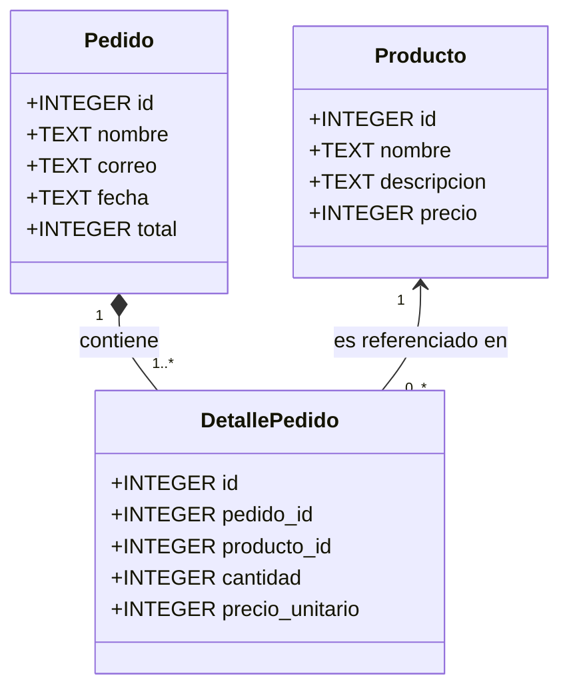
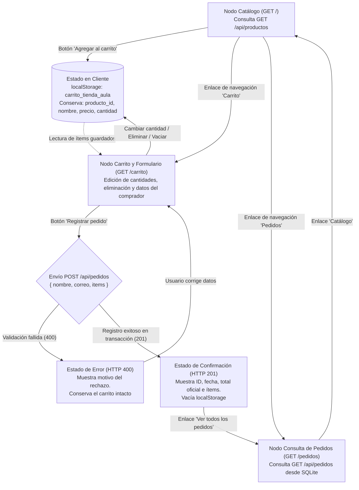

# Aplicación de la Metodología OOHDM — Tienda de Aula

- **Proyecto:** Primera versión de una tienda web (Práctica integradora del 20 %)
- **Temática:** Tienda de aula (Útiles escolares y de estudio)
- **Autor:** Juan Camilo Bedoya Holguin (Modalidad individual)
- **Asignatura:** Ingeniería Web — Universidad Cooperativa de Colombia

---

## 1. Diseño Conceptual

El modelo conceptual define las entidades del dominio de la tienda, sus atributos, relaciones y cardinalidades, de forma independiente a la tecnología o interfaz.

### Explicación de las clases y tratamiento de los datos del comprador
1. **`Producto`:** Representa cada artículo ofrecido en el catálogo de la tienda escolar. Contiene `id` (identificador único), `nombre`, `descripcion` y `precio` (valor unitario en pesos colombianos enteros positivos).
2. **`Pedido`:** Representa la orden de compra confirmada. Contiene `id` (asignado por la base de datos), `fecha` (asignada por el servidor) y `total` (calculado exclusivamente en el servidor a partir de los precios en SQLite).
   - **Tratamiento de los datos del comprador:** Siguiendo el alcance y el esquema del proyecto, no se utiliza una entidad ni tabla independiente de usuarios ni cuentas de autenticación. Los datos del comprador (`nombre` y `correo`) se modelan y almacenan directamente como atributos propios de la clase `Pedido` en el momento de confirmar la compra.
3. **`DetallePedido`:** Clase asociativa que representa cada renglón o línea de un pedido. Vincula un `Pedido` con un `Producto` específico (`pedido_id`, `producto_id`), registrando la `cantidad` comprada (entero positivo) y el `precio_unitario` vigente al momento de la compra para preservar la integridad histórica del pedido.

### Relaciones y cardinalidades
- Un **`Pedido`** contiene de **uno a muchos (`1..*`)** registros de **`DetallePedido`** (no puede existir un pedido válido sin al menos un detalle). Cada `DetallePedido` pertenece exactamente a **un (`1`)** `Pedido`.
- Un **`Producto`** puede estar referenciado en **cero o muchos (`0..*`)** registros de **`DetallePedido`** a lo largo de distintos pedidos, mientras que cada `DetallePedido` hace referencia exactamente a **un (`1`)** `Producto`.

---

## 2. Diseño Navegacional

El esquema navegacional describe el recorrido del usuario para consultar productos, organizar su carrito, registrar un pedido y consultar los pedidos almacenados.

### Información que se conserva entre nodos
1. **Del nodo Catálogo (`/`) al nodo Carrito (`/carrito`):**
   - Al agregar productos desde el catálogo, la información se conserva en el navegador mediante **`localStorage`** bajo la clave `'carrito_tienda_aula'`.
   - Se almacena un arreglo de objetos con `{ producto_id, nombre, precio, cantidad }`. Si el usuario agrega un producto que ya estaba en el carrito, se incrementa su `cantidad`. Esta información persiste al navegar entre páginas o recargar el navegador.
2. **Del nodo Carrito (`/carrito`) al estado de Confirmación:**
   - El navegador conserva los ítems del carrito mientras el usuario completa su `nombre` y `correo`.
   - Al enviar el formulario, se transmite al servidor mediante `POST /api/pedidos` únicamente `{ nombre, correo, items: [{ producto_id, cantidad }] }`.
   - **Si la solicitud falla (`400`):** El carrito **se conserva intacto** en `localStorage` y en la pantalla para que el usuario pueda corregir los datos sin perder su selección.
   - **Si la solicitud tiene éxito (`201`):** Se conserva en la vista el bloque de **Confirmación del pedido** con los datos oficiales devueltos por el servidor (`id` del pedido, `nombre`, `correo`, `fecha`, `total` calculado en servidor y desglose de `items` con `precio_unitario` y `subtotal`), y solo en ese instante se vacía el `localStorage`.
3. **Del estado de Confirmación al nodo Pedidos (`/pedidos`):**
   - La información del pedido y sus detalles se conserva de forma permanente en el archivo SQLite (`data/tienda.db`), por lo que al navegar a `/pedidos` (incluso tras reiniciar el servidor), la vista recupera todos los pedidos mediante `GET /api/pedidos`.

---

## 3. Diseño de Interfaz Abstracta

A continuación se especifican los bocetos de interfaz abstracta para las tres vistas de la aplicación (incluyendo la confirmación dentro de la vista del carrito), identificando la información visible, los campos de entrada, los botones de control y la respuesta esperada ante cada acción.

### Resumen por vista

| Vista / Nodo | Información visible | Campos de entrada | Botones / Controles | Respuesta esperada ante cada acción |
|---|---|---|---|---|
| **1. Catálogo (`/`)** | Encabezado de navegación, mensaje de estado (`#estado`) y cuadrícula de 6 tarjetas con nombre, descripción y precio en COP. | Ninguno. | Enlaces `Catálogo`, `Carrito`, `Pedidos`. Botón `Agregar al carrito` en cada tarjeta. | Al cargar: solicita `GET /api/productos` y muestra `"6 productos disponibles."`. Al pulsar `Agregar al carrito`: guarda/incrementa en `localStorage` y actualiza `#estado` indicando el producto agregado y el total de unidades. |
| **2. Carrito y Confirmación (`/carrito`)** | Mensaje de estado (`#estado`), tabla con Producto, Precio unitario, Cantidad, Subtotal y Acción; Total provisional; Formulario de comprador; Panel de confirmación (`#confirmacionPedido`). | `input[type=number]` para cantidad por fila; `input#nombre` (texto); `input#correo` (email). | Botón `Eliminar` por fila; botón `Vaciar carrito`; botón `Registrar pedido`; enlace `Ir al catálogo` o `Ver todos los pedidos`. | Al cambiar cantidad: recalcula subtotal y total provisional. Al eliminar/vaciar: retira ítem(s) y si queda vacío oculta tabla/formulario e informa que está vacío. Al enviar pedido válido: recibe `201`, vacía carrito y muestra confirmación con ID y total del servidor. Si falla (`400`): muestra error comprensible sin borrar el carrito. |
| **3. Consulta de Pedidos (`/pedidos`)** | Encabezado de navegación, mensaje de estado (`#estado`) y listado de tarjetas de pedidos con `#id`, nombre, correo, fecha, total en COP y tabla de productos comprados. | Ninguno. | Enlaces de navegación `Catálogo`, `Carrito`, `Pedidos` y botón `Ir al catálogo para comprar` (cuando no hay registros). | Al cargar: solicita `GET /api/pedidos`. Si hay registros, muestra la cantidad de pedidos y el detalle de cada uno; si devuelve `[]`, informa `"Todavía no hay pedidos registrados."`. |

```mermaid
flowchart TD
    subgraph V1 ["Boceto 1: Vista Catálogo (views/index.html)"]
        V1_NAV["Barra Navegación: [Tienda de aula] | Enlaces: Catálogo | Carrito | Pedidos"]
        V1_EST["Estado (#estado): '6 productos disponibles.' / Confirmación al agregar"]
        V1_GRID["Cuadrícula de Productos (#catalogo):<br/>Tarjeta: Nombre + Descripción + Precio ($ COP) + [Botón: Agregar al carrito]"]
        V1_NAV --- V1_EST --- V1_GRID
    end

    subgraph V2 ["Boceto 2: Vista Carrito y Confirmación (views/carrito.html)"]
        V2_NAV["Barra Navegación: Catálogo | Carrito | Pedidos"]
        V2_EST["Estado (#estado): Mensajes de actualización o de error HTTP 400"]
        V2_TAB["Tabla Carrito (#contenedorItems):<br/>Columnas: Producto | Precio unitario | [Campo: Cantidad] | Subtotal | [Botón: Eliminar]"]
        V2_RES["Resumen (#resumenCarrito): Texto 'Total provisional: $ XX.XXX' + [Botón: Vaciar carrito]"]
        V2_FORM["Formulario (#formPedido):<br/>[Campo: Nombre completo] + [Campo: Correo electrónico] + [Botón: Registrar pedido]"]
        V2_CONF["Panel Confirmación (#confirmacionPedido - visible tras HTTP 201):<br/>¡Pedido #ID registrado! + Comprador + Fecha + Total servidor + Lista de ítems + [Enlace: Ver todos los pedidos]"]
        V2_NAV --- V2_EST --- V2_TAB --- V2_RES --- V2_FORM --- V2_CONF
    end

    subgraph V3 ["Boceto 3: Vista Consulta de Pedidos (views/pedidos.html)"]
        V3_NAV["Barra Navegación: Catálogo | Carrito | Pedidos"]
        V3_EST["Estado (#estado): 'N pedido(s) registrado(s).' o 'Todavía no hay pedidos registrados.'"]
        V3_LIST["Listado de Tarjetas (#listaPedidos):<br/>Encabezado: Pedido #ID — Nombre | Correo | Fecha | Total ($ COP)<br/>Tabla interna: Producto | Cantidad | Precio unitario | Subtotal"]
        V3_NAV --- V3_EST --- V3_LIST
    end
```

---

## 4. Implementación y Arquitectura MVC en Capas

La implementación materializa los modelos anteriores en una aplicación web ejecutable en un solo proceso de Node.js utilizando módulos nativos (`node:http`, `node:fs`, `node:path`, `node:sqlite`) organizados bajo el patrón **MVC y arquitectura en capas**.

### Esquema de Arquitectura

```mermaid
flowchart LR
    subgraph Cliente ["Navegador Web (Cliente)"]
        V["Vistas HTML<br/>(views/index.html, carrito.html, pedidos.html)"]
        JS["Scripts Frontend + localStorage<br/>(public/catalogo.js, carrito.js, pedidos.js)"]
    end

    subgraph Presentacion ["Capa de Presentación y HTTP"]
        SRV["Arranque<br/>(server_rutas.js)"]
        RT["Enrutador<br/>(routes/rutas.js)"]
        CT["Controlador HTTP<br/>(controllers/tiendaController.js)"]
    end

    subgraph Negocio ["Capa de Lógica de Negocio"]
        MD["Modelo del Dominio<br/>(models/tiendaModel.js)"]
    end

    subgraph Datos ["Capa de Acceso a Datos y Persistencia"]
        RP["Repositorio SQLite<br/>(data/tiendaRepository.js)"]
        DB[("Base de Datos<br/>(data/tienda.db)")]
    end

    V --- JS
    JS <-->|"fetch() HTTP / JSON"| SRV
    SRV --> RT
    RT --> CT
    CT -->|"Invoca pasándole datos JS"| MD
    MD -->|"Consulta precios y solicita persistencia"| RP
    RP <-->|"Consultas preparadas y enTransaccion()"| DB
```

---

## 5. Tabla de Correspondencia (Diseño OOHDM vs. Implementación)

Esta matriz conecta las decisiones de diseño de OOHDM con las páginas, rutas, módulos y tablas concretas del proyecto:

| Decisión o Elemento de Diseño (OOHDM) | Página o Vista | Ruta HTTP / Endpoint | Módulo Responsable | Tabla o Almacenamiento |
|---|---|---|---|---|
| **1. Clase `Producto` y Nodo Catálogo** | `views/index.html` y `public/catalogo.js` | `GET /` y `GET /api/productos` | `controllers/tiendaController.js` → `models/tiendaModel.js` → `data/tiendaRepository.js` | Tabla `productos` (`id`, `nombre`, `descripcion`, `precio`) en `data/tienda.db` |
| **2. Conservación del Carrito entre nodos** | `views/carrito.html` y `public/carrito.js` | `GET /carrito` | `public/catalogo.js` y `public/carrito.js` (funciones `leerCarrito` y `guardarCarrito`) | `localStorage` del navegador (clave `'carrito_tienda_aula'`) |
| **3. Clase `Pedido` y datos del comprador** | Formulario en `views/carrito.html` | `POST /api/pedidos` | `models/tiendaModel.js` (`registrarPedido`: valida nombre/correo y calcula total con precios reales) | Tabla `pedidos` (`id`, `nombre`, `correo`, `fecha`, `total`) en `data/tienda.db` |
| **4. Clase `DetallePedido` y atomicidad de compra** | Panel de confirmación en `views/carrito.html` | `POST /api/pedidos` | `data/tiendaRepository.js` (`crearPedidoConDetalles` usando `enTransaccion`) | Tabla `detalle_pedido` (`id`, `pedido_id`, `producto_id`, `cantidad`, `precio_unitario`) |
| **5. Nodo de Consulta de Pedidos e historial** | `views/pedidos.html` y `public/pedidos.js` | `GET /pedidos` y `GET /api/pedidos` | `controllers/tiendaController.js` (`listarPedidos`) → `data/tiendaRepository.js` (`listarPedidosConDetalles`) | `JOIN` entre `pedidos`, `detalle_pedido` y `productos` en `data/tienda.db` |